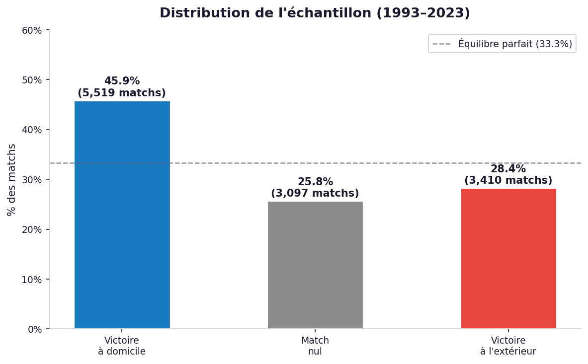

# ⚽ Home Advantage in the Premier League

---

## 📌 Overview

This project analyzes match data from the Premier League to evaluate the existence and magnitude of **home advantage**.

---

## 🎯 Objectives

* Compare home vs away win rates
* Analyze goal differences
* Identify trends over time
* Highlight team-level patterns

---

## 📊 Dataset

* ~12,000 matches
* Multiple seasons
* Match outcomes (H / D / A), goals, teams, dates

---

## 📈 Key Findings

* Home teams win significantly more matches
* Clear **home advantage effect**
* Variations across seasons and teams

---

## 🖼️ Example Visualization

<p align="center">
  
</p>

---

## 🛠️ Tech Stack

* Python
* Pandas
* Matplotlib / Seaborn

---

## 📂 Project Structure

```bash
data/
 ├── raw/
 ├── processed/

src/
 ├── analyse_exploratoire_rapport/  
 ├── data_preparation/  

outputs/
 ├── figures/
```

---

## 📄 Report

The full report is available in the repository for detailed methodology and analysis.

---

## 🚀 Extensions

* Add statistical modeling (logistic regression)
* Include team strength metrics
* Extend to other leagues

---

## 👥 Authors

* Salma Alaoui Mrani
* Lara Cunha

